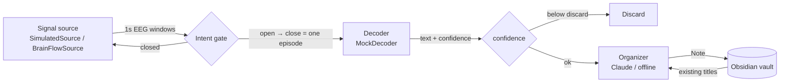

# Architecture



## Design principle: one interface per stage

Each stage is a `Protocol` (or a duck-typed class) with a single job. The pipeline only talks to those interfaces, so a simulated piece can be replaced by a real one without touching anything else.

| Interface | Method | Contract |
|---|---|---|
| `SignalSource` | `windows()` | yields `Window(data[channels, samples], sampling_rate, t_start, true_intent?)` |
| `IntentGate` | `update(focus, t)` | returns a `GateEvent("open"/"close")` when the state changes |
| `Decoder` | `decode(episode)` | returns `DecodedThought(text, confidence)` or `None` |
| `Organizer` | `organize(thought, existing_titles)` | returns a `Note` |
| `Vault` | `write_note(note, thought)` | writes Markdown and returns the path |

`true_intent` and `DecodedThought.intended` are ground truth that only exists in simulation. The pipeline uses them **only for metrics** (gate recall, false captures), never to make decisions.

## The intent gate

Speech BCIs need an explicit "on" signal, or private inner speech can leak into the output. NeuroVault's gate:

1. Computes relative band power per window (Hann-windowed periodogram, 1–45 Hz).
2. Focus index = `beta / (theta + alpha + beta)`. Alpha drops and beta rises during active mental effort.
3. Calibrates on the first 8 windows with **median + MAD**, so one stray blip during calibration doesn't push the threshold out of reach.
4. Opens after 2 consecutive windows above the threshold, closes after 2 below. That hysteresis is what filters out one-window distractions.

In the default simulation (60 seeds, 4 intents each), the gate catches about 99% of intended thoughts, with roughly one false capture every ten sessions. False captures produce low-confidence garbage, which the pipeline discards below `--discard-below`.

## Plugging in real parts

### A real headset

```bash
python -m neurovault run --source brainflow --board-id 0 --serial-port COM3   # OpenBCI Cyton
```

Board ids are listed in the BrainFlow docs. The gate threshold is recalibrated per session, so the user should stay relaxed for the first ~8 seconds.

### Recorded EEG

BrainFlow's `PLAYBACK_FILE_BOARD` replays a file recorded with any BrainFlow board, which allows tuning the gate on real data without wearing a headset.

### A real decoder

Implement:

```python
class MyDecoder:
    def decode(self, episode: list[Window]) -> DecodedThought | None:
        eeg = np.concatenate([w.data for w in episode], axis=1)
        text, conf = my_model.predict(eeg)
        return DecodedThought(text=text, confidence=conf)
```

and pass it to `Pipeline(decoder=MyDecoder(), ...)`. The public Brain-to-Text '24/'25 datasets (intracortical, 125k-word vocabulary) and EEG inner-speech datasets are good starting points for training.

## Why Claude sits after the decoder

Brain-to-text output is noisy, even at state-of-the-art word error rates. A language model downstream can:

- repair errors using context (`"viult cuuld sugget"` → `"vault could suggest"`),
- decide what kind of note it is and where it goes,
- connect it to what's already in the vault.

Both Claude backends share one prompt and one JSON schema:

- **`ClaudeCodeOrganizer`** runs `claude -p --output-format json --json-schema …` and reads `structured_output`. It's isolated with `--safe-mode`, `--tools ""` and `--no-session-persistence`, runs in an empty temp directory, and passes the system prompt through a file so it survives Windows `.cmd` wrappers. If an older Claude Code doesn't know one of the isolation flags, it drops that flag and retries once.
- **`ClaudeOrganizer`** calls the Messages API with a **forced tool call** (`tool_choice = file_note`).

Either way the response is validated structured data, and links are filtered against the real list of titles, so a hallucinated link can never be written.
